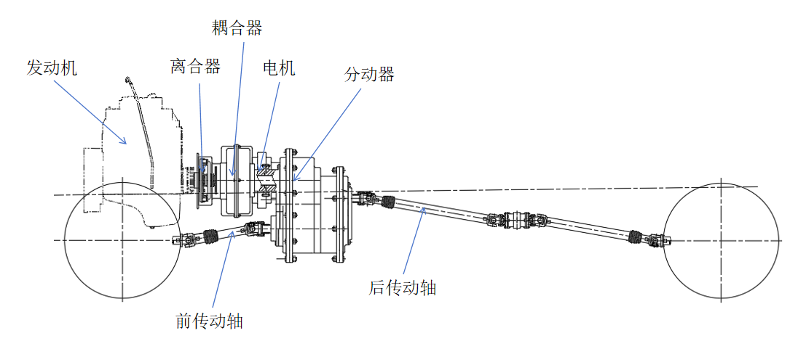
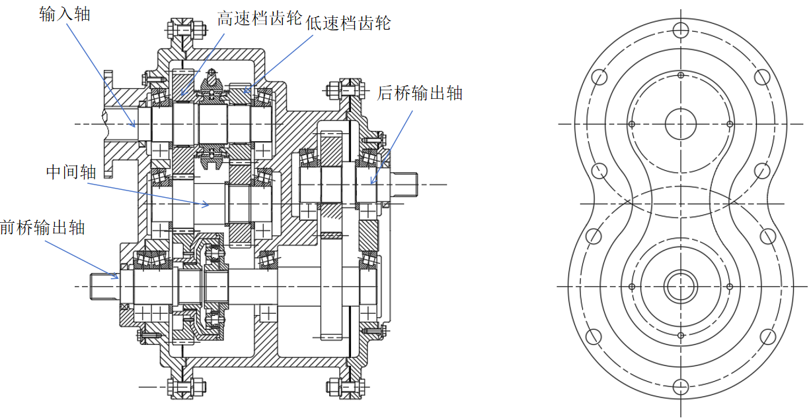

# Structural Design of a Power Distribution Unit for Four-Wheel Drive Hybrid Electric Vehicles

Undergraduate graduation project by Lufei Wang, Harbin Institute of Technology, May 2025. This repository collects the archived thesis, defense presentation and four engineering drawing sets.

The design covers the powertrain layout and power distribution strategy, a planetary-gear power coupler, a four-wheel-drive transfer case, and front/rear drive shafts. The documents contain design calculations and strength checks; this repository does not establish prototype testing or production readiness.

## Design at a glance

*Archived thesis figure: engine, motor, power coupler, transfer case and drive shafts. Original drawing labels remain Chinese.*

| Design question | Material to inspect |
| --- | --- |
| How are engine and electric-machine power combined? | Powertrain layout and planetary power-coupler design |
| How is torque distributed to the front and rear axles? | Transfer-case structure and shaft layout |
| How are components sized and checked? | Thesis design calculations and strength checks |

The deliverables are an engineering thesis and four drawing sets. Calculated component checks are documented in the thesis; they should not be interpreted as measured vehicle performance or prototype validation.

Transfer-case section drawing

## Read the project

- [English thesis — PDF preview](docs/thesis-en.pdf) · [editable Word version](docs/thesis-en.docx): English translation with the original engineering figures.
- [Chinese thesis PDF](docs/thesis.pdf): archived final version, 44 pages.
- [Editable thesis](docs/thesis.docx): Word version from the same archive.
- [Defense presentation](docs/defense.pptx): 22 slides from the final-defense folder.

| Drawing | PDF preview | Editable DWG |
| --- | --- | --- |
| Powertrain layout | [PDF](drawings/pdf/powertrain-layout.pdf) | [DWG](drawings/dwg/powertrain-layout.dwg) |
| Transfer case | [PDF](drawings/pdf/transfer-case.pdf) | [DWG](drawings/dwg/transfer-case.dwg) |
| Power coupler | [PDF](drawings/pdf/power-coupler.pdf) | [DWG](drawings/dwg/power-coupler.dwg) |
| Front and rear drive shafts | [PDF](drawings/pdf/front-rear-drive-shafts.pdf) | [DWG](drawings/dwg/front-rear-drive-shafts.dwg) |

Open PDFs first. Download Office files to read them locally, and use compatible CAD software for DWG files. No verified final 3D assembly was identified; the standalone reducer reference model is excluded.

---

# 四轮驱动混合动力汽车的动力分配装置结构设计

王陆飞，哈尔滨工业大学本科毕业设计，2025 年 5 月。本仓库收录归档论文、毕业答辩材料及四套工程图。

设计内容包括动力系统整体布置与动力分配策略、行星齿轮动力耦合器、四轮驱动分动器以及前后传动轴。材料包含设计计算及强度校核，不代表已完成样机试验或达到量产要求。

上方新增动力系统布置与分动器剖视预览。阅读时可沿着“动力耦合—前后轴分配—零件设计与强度校核”的顺序查看；计算结论不等同于样车实测结果。

## 阅读顺序

- [英文论文 PDF](docs/thesis-en.pdf)：可在线阅读；[英文 Word](docs/thesis-en.docx) 保留可编辑公式及原始工程插图。
- [中文论文 PDF](docs/thesis.pdf)：归档最终版本，共 44 页。
- [论文 Word](docs/thesis.docx)：同一归档目录中的可编辑版本。
- [毕业答辩 PPT](docs/defense.pptx)：取自结题文件夹，共 22 页。

| 工程图 | PDF 预览 | DWG 源文件 |
| --- | --- | --- |
| 动力系统整体布置图 | [PDF](drawings/pdf/powertrain-layout.pdf) | [DWG](drawings/dwg/powertrain-layout.dwg) |
| 分动器装配图 | [PDF](drawings/pdf/transfer-case.pdf) | [DWG](drawings/dwg/transfer-case.dwg) |
| 动力耦合器装配图 | [PDF](drawings/pdf/power-coupler.pdf) | [DWG](drawings/dwg/power-coupler.dwg) |
| 前后传动轴装配图 | [PDF](drawings/pdf/front-rear-drive-shafts.pdf) | [DWG](drawings/dwg/front-rear-drive-shafts.dwg) |

建议先阅读 PDF。Office 文件下载后打开，DWG 使用兼容 CAD 软件查看。未确认独立的最终三维总装，暂不收入参考减速机模型。

